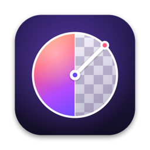
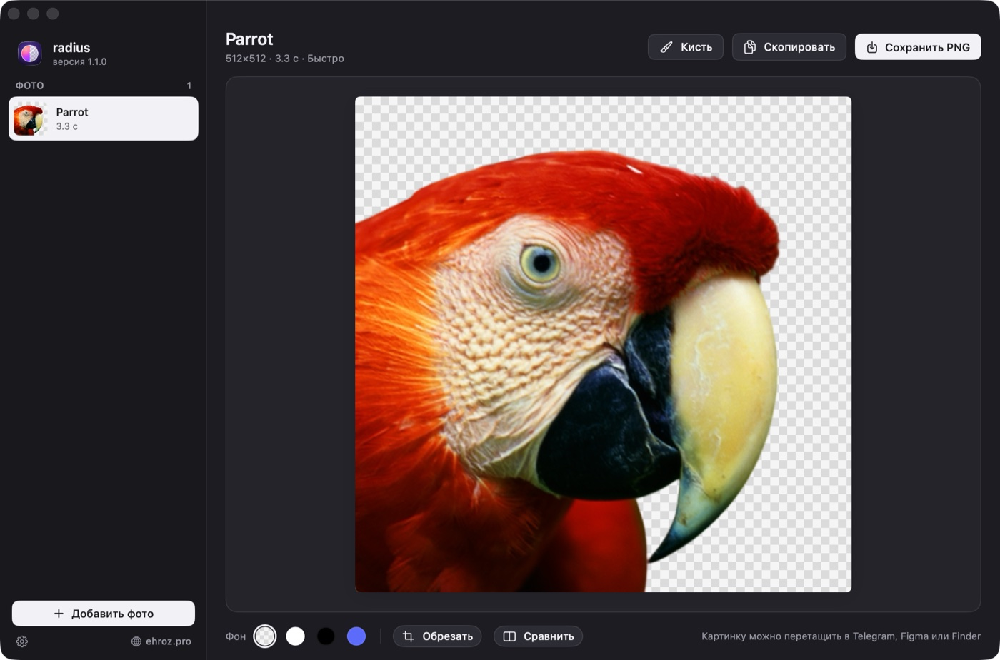

<h1 align="center">radius</h1>

Удаление фона с фото для macOS — локально, на видеокарте Mac. Перетащи фото — получи PNG без фона.

<a href="https://github.com/ehroz1/radius-releases/releases/latest"><b>⬇︎ Скачать последнюю версию</b></a> · <a href="https://ehroz.pro"><b>ehroz.pro</b></a>

## Установка

1. Скачайте `radius-<версия>.dmg` из [последнего релиза](https://github.com/ehroz1/radius-releases/releases/latest).
2. Откройте его и перетащите **radius** в папку «Программы».
3. Первый запуск: правый щелчок по radius → «Открыть» → «Открыть».
   Если macOS всё равно не пускает: «Системные настройки → Конфиденциальность и безопасность → Всё равно открыть»
   или в Терминале `xattr -dr com.apple.quarantine /Applications/radius.app`.

При первом запуске radius проведёт короткое знакомство и скачает модель BiRefNet (≈410 МБ, один раз).
Работает на macOS 15 и новее, Apple Silicon.

## Что умеет

- Убирает фон моделью BiRefNet прямо на Mac: без интернета, без подписок, фото никуда не уходят.
- Два режима: «Быстро» (1024 px, ~1,5 с) и «Максимум» (HR-matting, 2048 px — волосы, мех, стекло).
- Кисть «Стереть / Вернуть» с отменой и масштабом — поправить край за пару мазков.
- Фон: прозрачный, белый, чёрный или свой цвет; обрезка по объекту; сравнение с оригиналом.
- Правый клик по фото в Finder → «Удалить фон (radius)» — без открытия окна.
- Настройки хранятся в отдельном файле и переживают переустановку.

## Обновления

radius обновляется сам: раз в полчаса он проверяет этот репозиторий, и в боковой панели появляется
**«Доступна версия X»**. Один щелчок — новая версия скачивается, проверяется (SHA-256 и подпись) и
ставится с перезапуском. Можно без щелчка: «Настройки → Обновления → Ставить сразу».

---

Здесь только готовые сборки. Сделано в [ehroz.pro](https://ehroz.pro).
